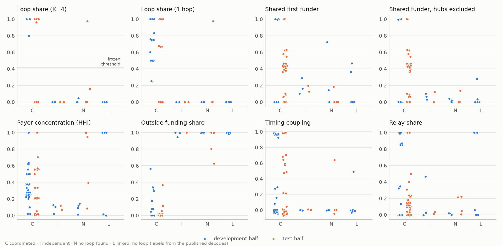
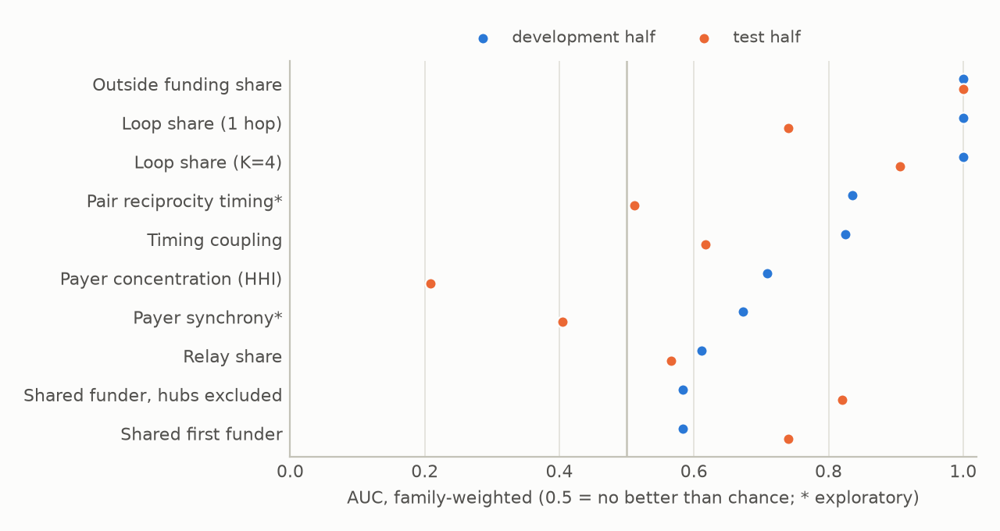
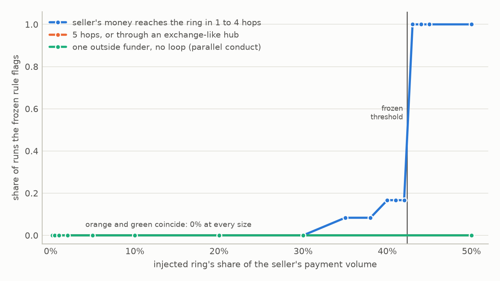
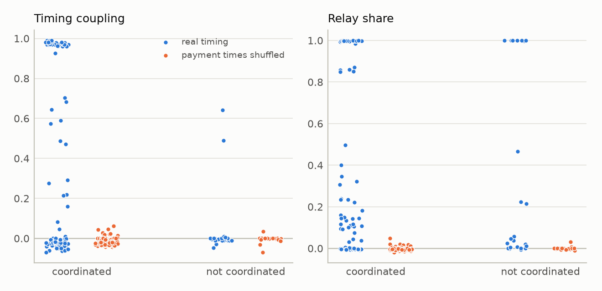

# Plus Factors on the Ledger: Testing Evidence of Coordinated Demand in Live AI-Agent Payment Markets

<p class="authors">Marley, ChainWard (chainward.ai)</p>
<p class="venue">Apart AI Collusion Research Sprint, October 23 to 25, 2026. Track 2: Detection and Audit of Collusion (research question 2.3)</p>

<div class="abstract">

## Abstract

What should count as convincing evidence that AI agents collude? We test candidates in two live AI-agent markets with public payments: x402 on Base and TermiX's agent-hiring escrow on BNB Chain. Labels for the 123 cases (a payee in a 7-day window; 20 families) come from ChainWard investigations published before the sprint. We chose a rule over eight pre-registered features on 10 development families, froze it in a commit and tested it on 10 held-out families. The frozen rule flags a payee when at least 42% of its payment value comes from payers its own money reached within four transfers, exchanges excluded. On the test half it caught 38 of 42 coordinated cases and flagged 1 of 6 others (family-weighted balanced accuracy 0.82, 95% interval 0.56 to 1.00, permutation p = 0.024). A rule on buyers' lack of outside money scored 0.90. Evidence that antitrust would call parallel conduct separated poorly: over all cases the AUC was 0.63 for a shared funder, 0.47 for payer concentration and 0.70 for timing. Injected into 12 real markets, a synthetic ring the seller's money reached within four transfers was always flagged at half the seller's volume and never at 30% or less; behind an exchange-like hub, never. The labels rest partly on the same funding evidence; a rule on features they did not use scored 0.67 (p = 0.14). Here, money returning to the seller and buyers without outside money behaved as plus factors; shared funders, concentration and timing did not.

</div>

## 1 Introduction

AI agents now pay each other. With x402, a server answers an HTTP request with a price and the client pays by signing a USDC transfer that a facilitator settles on-chain (Coinbase, n.d.; Kim et al., 2020). On TermiX, agents registered in the ERC-8004 identity registry hire other agents through an escrow that pays the seller minus a 2% fee (De Rossi et al., 2025; [D7]). These markets reward measured demand: public leaderboards rank x402 sellers by the USDC they receive [D4], TermiX awards points for jobs [D7], and BNB Chain's Set and Earn campaign rewards participants whose agents other wallets hire [D5]. That invites a seller to fund its own buyers, or a group of wallets to hire each other. ChainWard's investigations ("decodes") published before the sprint found both: a seller whose buyers' first USDC came from the seller, six wallets that paid only each other, and 48 wallets that hired only within their own group [D1]–[D6]. Fabricated volume bought rankings on crypto exchanges in the same way (Cong et al., 2023).

Research question 2.3 of this sprint asks what should count as convincing evidence of collusion. Antitrust law met the problem long ago: similar behaviour by competitors (parallel conduct) is lawful on its own (Bell Atlantic v. Twombly, 2007), and inferring an agreement takes additional evidence, the plus factors (Kovacic et al., 2011; Berger et al., 2025). Most work on collusion between AI agents studies simulated games in which the experimenter knows who colludes (Calvano et al., 2020; Fish et al., 2024; Lin et al., 2024; Agrawal et al., 2025; Nakamura et al., 2026). We take the opposite trade: weaker ground truth (published investigations) for real markets with a complete public record of actions. A payment cannot be reworded after the fact.

We ask which ledger evidence separates coordinated from independent demand, and whether a rule chosen on half of the cases holds on the other half. Our contributions are **a labelled case set from live agent markets** (123 cases in 20 families, each tied to a published quote and to the evidence the investigation used, so that circularity can be measured); **a pre-registered test** (split and hypotheses committed before any feature was computed, the rule frozen in a commit before the held-out half was scored, with bootstrap intervals and an exact permutation test); **controls** (a synthetic ring injected into real markets, shuffled payment times, sensitivity to the free settings); and **an answer to 2.3 in antitrust terms**: money that returns to the seller and buyers without outside money act as plus factors, while a shared funder, concentrated demand and timing behave like parallel conduct.

**Terms.** A payee's demand is *coordinated* when the money paying it comes from the payee itself or circulates in a closed group. One operator with many wallets and several operators acting together look the same on a ledger, and a ranking or incentive program is misled the same way, so we do not separate them. The units are wallets, not people or models: both markets are built for AI agents, but the chain does not show which wallets an LLM agent runs.

**Preexisting work and AI assistance.** The case labels come from six ChainWard decodes published Sep 27 to Oct 13, 2026 [D1]–[D6]; a seventh [D7] is background. ChainWard's hire check and seller-demand check (paid API endpoints) and its Base node also predate the sprint. The checks compute nothing here, the node is only a data source, and the decodes' own scripts and data are not used (their published counts serve only as checks): the chain was pulled again. Everything in the repository (case registry, pulls, features, rule search, controls, figures) and this report are new sprint work; the code and results were built on Oct 23, 2026 (UTC). The code, the analysis and this report were written with AI coding agents; the team is responsible for every claim.

## 2 Related work

**Collusion without talk.** Q-learning pricing algorithms learn supracompetitive prices without communicating (Calvano et al., 2020); LLM pricing agents reach them quickly, and prompt wording moves them (Fish et al., 2024); LLM agents divide multi-commodity markets (Lin et al., 2024); seller communication raises collusion in LLM double auctions (Agrawal et al., 2025). Independent bandit learners can produce collusive-looking outcomes with no coordination at all (Douglas et al., 2024), which is the evidentiary problem in miniature: the outcome does not reveal an agreement. Collusion is one of three failure modes in the taxonomy of multi-agent risks by Hammond et al. (2025).

**Detection and audit.** Bonjour et al. (2022) detect colluding players from the mutual information between their actions. Colosseum (Nakamura et al., 2026) measures collusion through actions, as regret against the cooperative optimum, and compares it with what agents say; agents that plan collusion in text often pick non-collusive actions ("collusion on paper"). Agents can also hide coordination inside innocuous text (Motwani et al., 2024). Both results favour evidence from actions, and a payment ledger is such a record: complete and public, whatever the agents said.

**Evidentiary standards.** Under US antitrust law, parallel conduct is as consistent with independent decisions prompted by common perceptions of the market as with conspiracy, so a claim needs facts suggesting a preceding agreement; the commentators the Supreme Court cites look for parallel behaviour that would probably not result from chance, coincidence or independent responses to common stimuli (Bell Atlantic v. Twombly, 2007). Kovacic et al. (2011) define plus factors as actions and outcomes, beyond parallel conduct, that are largely inconsistent with unilateral conduct but consistent with explicit coordination, and propose ranking them by probative strength. Berger et al. (2025) ask how this framework applies when competitors coordinate through shared pricing algorithms. The sprint notes that ML work on collusion detection largely re-derives this doctrine without naming it. We borrow its logic, not its legal category: here coordination links a seller with its buyers, or one operator's wallets, rather than competitors.

**On-chain forensics.** Address clustering infers common control of Ethereum accounts from usage patterns such as deposit-address reuse (Victor, 2020). Wash-trading studies find closed cycles of trades among accounts whose positions do not change (Victor and Weintraud, 2021) or statistical irregularities in reported volume (Cong et al., 2023). Our loop share applies the cycle idea to payments for services. What is new here is the evaluation: a frozen rule scored on held-out labelled cases from live agent markets, positive and negative controls, and a mapping of each kind of evidence onto plus factors and parallel conduct.

## 3 Methodology

### 3.1 Markets and data

**Base (x402).** An x402 payment on Base is a USDC transfer that the payer authorizes with an EIP-3009 signature and a facilitator submits. We pulled every USDC `Transfer` and `AuthorizationUsed` log on Base from 2026-09-01 00:00 to 2026-10-12 23:59:59 UTC (blocks 50,715,727 to 52,530,126): 157,753,459 transfers, with no gaps and no thin segments. Of the 38 segments, 24 came from two public endpoints (at most 2 requests a second each) and the rest from ChainWard's node; 72 random 40-block ranges from the public segments were re-read from the node and matched row for row, and three incomplete segments from one endpoint were discarded and pulled again.

**BNB Chain (TermiX).** We pulled every log of TermiX's two escrow contracts from Sep 17 to Oct 8, 2026 (blocks 122,313,771 to 126,344,213), querying each chunk twice (0 disagreements), and the ERC-8004 owner of every agent hired. Our count of hires in the Set and Earn window, 10,325, equals the published count, as do all 7 daily counts; on 30 sampled settlements the escrow paid the agent's owner every time. Plain USDC and USDT transfers on BNB Chain could not be pulled at the allowed pace from keyless endpoints, so the BNB Chain evidence is the market's own hire graph.

### 3.2 Cases and labels

A case is one payee (an x402 seller's payTo address, or the owner of a hired agent) in one 7-day window: four Base windows from Sep 15 to Oct 13 and one BNB Chain window, Oct 1 to 8. A case enters only if a published decode makes a statement about that payee covering that window, and cases with no payments are dropped (3 were). Labels: **C** coordinated (the decode reports a loop, a closed ring or buyers funded by the seller); **I** independent (positive evidence such as many distinct funders or buyers who also pay other sellers); **N** no loop found (a weak negative that the decodes say is not a clearance); **L** linked, no loop (a strong common link, such as one wallet funding many buyers or an on-ramp, that the decode explicitly did not count as a loop). The detection target is C against the rest. The set has 98 C, 12 L, 8 N and 5 I cases (59 on Base, 64 on BNB Chain); Appendix C lists the families. Each family records the decode's quote and the evidence it used, so we can say which features re-derive the label.

The two BNB Chain rings are rebuilt from the decodes' published descriptions (an agent-id range and the round structure, not the wallets) and reproduce the published counts: 48 wallets in closed hire groups of 24, 12 and 12 with 218 orders, 216 of them settled; and a 14-wallet group with 38 hires inside on Oct 1, 4 and 6, no hire in and one out. Both are defined by the closure of their hiring, so their loop share is high almost by construction; they test the pipeline more than the evidence.

### 3.3 Definitions

All definitions were fixed before any case was scored. The *lookback* is the 14 days before the window. A *payment* on Base is a USDC transfer into the payee inside the window that the payer authorized with EIP-3009, directly or through a facilitator proxy that forwards it in the same transaction; on BNB Chain it is a TermiX order created for the payee's agent (payer = hirer, value = budget). *Forwarding*: a transfer X to Z that follows Y to X in the same transaction and carries 50% to 100% of it counts as Y to Z, so proxies and routers are passed through. A *hub* is an address with at least 1,000 distinct counterparties in lookback plus window (on BNB Chain, in the hire graph); hubs (exchanges, routers, bridges, custodial accounts) are never walked through. The *reach set* is every wallet reachable from the payee through non-hub wallets in at most K = 4 transfers in lookback plus window (on BNB Chain, through settled hires). The walk stops after 200,000 visited wallets; the 10 cases that reached this cap did so at hop 5 or 6, so the K = 4 features are complete.

The framing comes from the hypotheses, committed before any feature was computed: a plus factor is behaviour that makes sense only under coordination, above all paying fees to move one's own money in a circle; parallel conduct is similarity that shared infrastructure also produces (the same funder, a few payers, the same timing). `outside_funding_share` asks where the payers' money came from, so it sees loops one transfer longer than K.

<div class="tbl">

Table 1: The evidence features (code: `src/features.py`). Timing nulls shift each payer's payment times circularly by a random offset inside the window (mean of 200 shifts). The last column is the role the hypotheses gave each feature before any value was computed.

| Feature | Definition | Role in the hypotheses |
|------------------|------------------------------------------------|--------------|
| `loop_share` | Share of payment value from payers in the payee's reach set | Plus factor (H1) |
| `loop_share_1hop` | Same with K = 1: payers the payee paid directly | Not assigned (1-hop loop) |
| `outside_funding_share` | Share of the value flowing into payers (lookback plus window) from wallets other than the payee, the payers and the reach set; 1 if payers received nothing | Not assigned |
| `shared_funder_share` | Value share of the payers behind the most common first funder (sender of a payer's first non-zero inflow), counting only funders of 2 or more payers | Parallel conduct (H2) |
| `shared_funder_share_nonhub` | Same, but a hub never counts as a shared funder | Parallel conduct (H2) |
| `payer_hhi` | Herfindahl index of payment value across payers | Parallel conduct (H3) |
| `timing_coupling` | Share of payments within 1 hour after any transfer out of the payee, minus the null | Timing (H4) |
| `relay_share` | Share of payments within 10 minutes after the payer received money, minus the null | Timing (H4) |
| `pair_reciprocity_timing`* | Share of payments within 1 hour after the payee paid that same payer, minus the null | Exploratory |
| `payer_synchrony`* | Share of payments within 10 minutes of a payment by a different payer, minus the null | Exploratory |

\*Added after a one-day debug run showed `timing_coupling` saturating for payees that send thousands of transfers; reported, never used in the rule search.

</div>

### 3.4 Protocol

1. The case registry and the split were committed first (commit `dd05819`, Oct 23 06:01 UTC). Whole families are split, so weekly repeats of a seller and the members of a ring never straddle halves; the split is stratified by coordinated × chain with a seeded shuffle (seed 20261023): 10 development families (4 coordinated, 75 cases) and 10 test families (5 coordinated, 48 cases).
2. Hypotheses H1 to H5 and the positive-control prediction were committed at 06:50 UTC (`d765207`), before any feature was computed.
3. Features were computed for all cases without printing test-half values.
4. The rule search read the development half only: every single-feature threshold and every two-feature AND or OR rule over the eight pre-registered features, scored by family-weighted balanced accuracy (each family weighs 1, split equally across its cases). Ties go to fewer features, then the wider margin (distance from the threshold to the nearest development value, as a share of the feature's range), then the name. A second rule was chosen the same way from the features the decodes did not use for labelling (`payer_hhi`, `timing_coupling`, `relay_share`), and the best threshold for each single feature was recorded.
5. The rules were frozen in commit `f99f40eb42b69b7d90dcf76305db08a6b42f92d2` (11:10 UTC) and then scored on the test half (`563d219`, 11:43 UTC). Commit times are the repository's own and are not externally timestamped.

Uncertainty comes from a bootstrap over families, resampled with replacement within each class (B = 5,000), and an exact permutation test over all 252 ways of choosing which 5 of the 10 test families are coordinated. Deviations from the plan, all disclosed in the repository: before the freeze, a smoke test on a one-day slice printed feature values for three development cases and payment counts for test cases, and showed that the payers of BotPay, a test family, sit five transfers from its payTo (no test-half feature value was seen, and K = 4 was kept); the two exploratory features were added after it; the 48-wallet ring was first rebuilt by id range alone (58 wallets, rejected before features were computed); and a fine positive-control grid was added after the pre-set grid ran.

### 3.5 Controls

**Positive control.** Into the real data of each market the decodes did not label coordinated or linked (labels I or N, at least 5 payers; 12 markets once Losbeto, which the rule already flags, is excluded at reporting time; with it, every route shows 1 of 13 flagged) we inject a ring of 5 synthetic payers carrying a share φ of the seller's payment volume, φ ∈ {0.2, 0.5, 1, 2, 5, 10, 20, 30, 50}%, with 10 seeds per setting. Routes: the seller pays the ring payers directly, through relays (2 or 4 hops), through 4 relays (5 hops, one beyond K), through an exchange-like hub, or not at all, with one outside wallet funding all 5 payers (parallel conduct with no loop). **Negative control.** Each payer's payment times are shifted circularly inside the window (3 seeds), which destroys timing dependence and keeps payers, amounts and the graph. **Sensitivity.** The frozen thresholds are applied to features recomputed with K = 1 to 6 and with hub thresholds of 300 and 3,000.

## 4 Results

### 4.1 The frozen rule on the test half

All 40 rules kept on the development leaderboard scored balanced accuracy 1.00, so the tie-break decided: `loop_share >= 0.4235`. In words, flag a payee when at least 42% of its payment value comes from payers that its own money reached within four non-hub transfers. The threshold sits midway between the development cases, which all lay near 0 or near 1 (Figure 1). On the test half (Table 2) the primary rule's balanced accuracy of 0.82 is unlikely under chance: of the 252 ways to choose 5 coordinated families among the 10, 2.4% score at least as well (p = 0.024). Unweighted, the test result is TPR 0.90 and FPR 0.17; over both halves the rule flagged 94 of 98 coordinated cases and 1 of 25 others. Outside funding share alone did better on the test half (0.90), but it tied with loop share on the development half and lost the margin tie-break; we report it as found and do not switch rules after seeing the test half.

<figure>

<figcaption><b>Figure 1.</b> Every pre-registered feature by label, development half (blue) and test half (orange); the line in the first panel is the frozen threshold. C coordinated, I independent, N no loop found, L linked without a loop.</figcaption>
</figure>

<div class="tbl">

Table 2: Frozen rules on the test half (10 families, 5 coordinated; 42 coordinated and 6 other cases). Rates are family-weighted, intervals are 95% bootstrap intervals over families, and p is the exact permutation p-value. The last seven rows are the best single-feature thresholds from the development half, frozen with the primary rule and shown for comparison.

| Rule (frozen on the development half) | Dev BA | Test TPR | Test FPR | Test BA [95% CI] | TP/FN/FP/TN | p |
|----------------------------------------|------|------|------|--------------|-----------|-----|
| **Primary:** `loop_share >= 0.4235` | 1.00 | 0.84 | 0.20 | **0.82** [0.56, 1.00] | 38/4/1/5 | 0.024 |
| **Non-circular:** `timing_coupling >= -0.001939 AND relay_share >= 0.09579` | 0.93 | 0.54 | 0.20 | 0.67 [0.40, 0.91] | 17/25/1/5 | 0.14 |
| `outside_funding_share <= 0.7537` | 1.00 | 1.00 | 0.20 | 0.90 [0.70, 1.00] | 42/0/1/5 | |
| `loop_share_1hop >= 0.125` | 1.00 | 0.59 | 0.20 | 0.69 [0.40, 0.98] | 33/9/1/5 | |
| `timing_coupling >= 0.04143` | 0.84 | 0.59 | 0.20 | 0.70 [0.44, 0.91] | 17/25/1/5 | |
| `relay_share >= 0.09579` | 0.72 | 0.64 | 0.40 | 0.62 [0.33, 0.88] | 26/16/2/4 | |
| `shared_funder_share >= 0.8571` | 0.75 | 0.20 | 0.00 | 0.60 [0.50, 0.80] | 2/40/0/6 | |
| `shared_funder_share_nonhub >= 0.6354` | 0.75 | 0.20 | 0.00 | 0.60 [0.50, 0.80] | 2/40/0/6 | |
| `payer_hhi >= 0.01951` | 0.75 | 0.58 | 1.00 | 0.29 [0.13, 0.45] | 35/7/6/0 | |

</div>

### 4.2 Which evidence separates

The two plus-factor features separated the labelled cases on both halves (Table 3, Figure 2). The parallel-conduct features did not: a shared first funder and payer concentration were weak or unstable between halves, payer concentration pointed the wrong way on the test half (AUC 0.21), and the payer-concentration rule flagged all six non-coordinated test cases. Timing carried signal on the development half that mostly did not carry over.

<div class="row">
<div class="col-table">

Table 3: Single-feature AUC, family-weighted, oriented so that higher means more coordinated (outside funding share reversed); 0.5 is chance. *Exploratory.

| Feature | Development | Test | All cases |
|------------------------------|----------|----------|----------|
| Loop share (K = 4) | 1.00 | 0.91 | 0.97 |
| Outside funding share | 1.00 | 1.00 | 1.00 |
| Loop share (1 hop) | 1.00 | 0.74 | 0.87 |
| Shared first funder | 0.58 | 0.74 | 0.63 |
| Shared funder, hubs excluded | 0.58 | 0.82 | 0.71 |
| Payer concentration (HHI) | 0.71 | 0.21 | 0.47 |
| Timing coupling | 0.83 | 0.62 | 0.70 |
| Relay share | 0.61 | 0.57 | 0.61 |
| Pair reciprocity timing* | 0.84 | 0.51 | 0.66 |
| Payer synchrony* | 0.67 | 0.40 | 0.49 |

</div>
<div class="col-figure">
<figure>

<figcaption><b>Figure 2.</b> Single-feature AUC (family-weighted) on the development and test halves; 0.5 is chance.</figcaption>
</figure>
</div>
</div>

### 4.3 Errors

**Misses.** All four false negatives are BotPay's main payTo (`0x159be9e3…`) in its four weeks, with 298 to 346 payers each. Its payers sit five transfers from the payTo, one beyond the reach limit, as hypothesis H5 stated before scoring (written after a debug slice showed it); at K = 5 their loop share is at least 0.999 in every week. Outside funding share, which looks one transfer further, caught all four (at most 0.054).

**False positive.** Losbeto in W4 (`0xd5ba9711…`, label N): one payer carried 97% of its payment value ($158.79), and in lookback plus window the seller sent that same wallet $406.17. The decode read the seller's outflows as payouts to people. By the ledger, the payee and its main payer pay each other; what the payments were for (refunds, winnings, wages or self-funding) is not on-chain. The development half holds the mirror case: F07, whose seller sent 91% of its takings back to its buyers [D1], is labelled C but contested, since it may be a game working as designed.

### 4.4 Positive control

When the seller's money reached the ring within four transfers (directly or through relays), the injected ring was flagged in 100% of runs at 50% of the seller's volume and in 0% of runs at 30% or less (Figure 3). The cut-off is where loop share crosses the threshold: a ring with share φ in a market with existing loop share b has loop share φ + (1 − φ)·b, so it is flagged once φ ≥ (0.4235 − b)/(1 − b), which is 31.5% to 42.4% across the 12 markets. On the fine grid, 0% of markets were flagged at 30%, 17% at 40% to 42% and 100% at 43%. Routed over five hops or through an exchange-like hub, the ring was never flagged at any size (0% of runs), and five payers funded by one outside wallet with no loop were never flagged either (0%). The injection sets each ring payer's distance directly, so this checks the features and the threshold, not the reach walk; the rule's blind spots are exactly the routes it does not walk. It also misses partial rings, under about a third of a seller's volume: the development set held none, so the margin rule put the threshold midway between 0.05 and 0.80.

<figure>

<figcaption><b>Figure 3.</b> Positive control: share of injection runs the frozen rule flags, by the injected ring's share of the seller's payment volume (12 real markets, 10 seeds per setting; points between 30% and 50% come from the fine grid). The orange and green lines coincide at 0%.</figcaption>
</figure>

### 4.5 Timing, and the shuffle control

Timing is the evidence the decodes did not use. The shuffle control shows that the signal is real: circularly shifting each payer's payment times took the coordinated cases' mean timing coupling from 0.36 to −0.02 and the non-circular rule's flag rate on them from 0.50 to 0.00, while the primary rule, which uses no timing, flagged exactly the same cases (Figure 4, Appendix D). The signal is weak, though: the non-circular rule scored 0.67 on the test half (p = 0.14), and its frozen thresholds sit inside the null's sampling noise, so its outputs move when the number of null draws changes. Relay share is high in non-coordinated markets too (mean 0.32, against 0.41 in coordinated ones): checkout flows fund a wallet and pay at once, as with Korus's one-off buyers (relay share 0.998, label L).

### 4.6 Sensitivity

With the frozen threshold applied to features recomputed at reach depth K = 1, 2, 3, 4, 5 and 6, the test TPR was 0.59, 0.59, 0.80, 0.84, 1.00 and 1.00, and the FPR was 0.20 at every depth except K = 6 (0.40, where CheapTokens' loop share rises from 0.16 to 0.75). Hub thresholds of 300 and 3,000 left the test result unchanged (TPR 0.84, FPR 0.20). K = 5 would have caught BotPay, but K was fixed before scoring, and this is a post-hoc observation on the test half.

### 4.7 The hypotheses, checked

H1 (loop share separates) held. H2 (a shared-funder rule flags the L cases) failed as stated: the frozen threshold (0.857) sat above every development non-coordinated case, so the rule flagged no L case and caught one test family, and AX1's seeding wallet, expected not to be a hub, has at least 1,000 counterparties (hub-excluded share 0.03 instead of 0.47). Only its premise held: shared funding separated poorly (AUC 0.63 over all cases). H3 (concentration is not evidence), H4 (timing weaker than loops; relay share confounded by checkouts), H5 (BotPay missed at K = 4) and the positive-control prediction held.

## 5 Discussion

**What should count as convincing evidence of collusion?** On a payment ledger, our answer has three parts.

1. *Count money that comes back, and buyers without money of their own.* Loop share and outside funding share separated the labelled cases on both halves (test balanced accuracy 0.82 and 0.90), and loop share behaved as designed on rings with known parameters. In these data they behave like plus factors (but see Circularity below). An independent buyer spends its own money; a seller that funds its buyers pays fees to move its own money in a circle, which only pays if something rewards measured demand (a leaderboard rank, campaign rewards, points). That conduct is largely inconsistent with unilateral conduct and largely consistent with explicitly coordinated action, which is how Kovacic et al. (2011) define a plus factor.
2. *Treat a shared funder, a few large payers and synchronized timing as grounds to look, not to conclude.* Shared infrastructure can produce all three without any agreement, as the decodes read these cases: an app seeding embedded wallets for its users (AX1), one-off checkout wallets funded through an on-ramp (Korus), an account both sides may use (the round-trip family), a few large customers (SurplusIntelligence, concentration 0.998). If so, these are independent responses to common stimuli, in the phrase Twombly quotes; they separated poorly (AUC 0.47 to 0.71 over all cases), partly because the decodes counted only loops as coordination. Incentive programs already write such tests into their rules: Set and Earn's fair-play terms exclude wallets that share a common funding source as well as wallets that transact circularly [D5]. Our results support the second test much more than the first.
3. *Even a plus factor is not proof of intent.* Losbeto shows that payouts, refunds or wages make loops; F07 may be a game. The ledger shows where money went, not who controls a wallet or what a payment was for. A market can treat a loop as shifting the burden: the seller explains it (with a published payout schedule, say) or its demand is discounted.

**Circularity.** The labels were mostly reached by tracing where buyers' money came from, which is close to what loop share and outside funding share measure (Appendix C). The test therefore shows that a frozen, mechanical version of that reasoning reproduces the decodes' judgments on unseen families, computed over every payment rather than the samples the decodes traced; it does not validate the evidence independently. The rule restricted to features the decodes did not use (0.67, p = 0.14) is the estimate that does not lean on the labels' own evidence, and it is weak. The positive control is label-free but synthetic.

**What a market can require.** A threshold invites evasion (Appendix A); a sturdier standard asks for evidence of independence a ring cannot cheaply fake, such as outside funders and buyers who also pay other sellers.

**For AI collusion research.** Ledgers give action evidence that agents cannot edit and that needs no access to their messages, a complement to monitors that read talk, which can overstate collusion ("collusion on paper", Nakamura et al., 2026) or miss it, as with Colosseum's hidden collusion or steganographic talk (Motwani et al., 2024). Markets that log agents' messages next to their payments would allow the combined test of question 2.2.

## 6 Conclusion

On two live markets built for AI agents, a rule frozen before it saw the test half reproduced the decodes' split of coordinated from independent demand by asking one question: did the payee's own money come back as its payments? Whether the buyers had outside money did as well; a shared funder, a few large payers and synchronized timing, the ledger's parallel conduct, did not. This suggests a screening standard for markets that rank or reward agents by demand, with known limits: labels from one team that partly share the rule's evidence, ten test families, and blind spots at exchanges, beyond four transfers, and outside USDC on Base and TermiX's hire records. The next step is labels the rule did not inform, from another team or a market's own enforcement.

**Code and Data:** https://github.com/saltxd/onchain-collusion-evidence

<div class="pagebreak"></div>

## References

<div class="refs">

Agrawal, K., Teo, V., Vazquez, J. J., Kunnavakkam, S., Srikanth, V., and Liu, A. (2025). Evaluating LLM agent collusion in double auctions. arXiv:2507.01413. https://arxiv.org/abs/2507.01413

Bell Atlantic Corp. v. Twombly, 550 U.S. 544 (2007). https://www.courtlistener.com/opinion/145730/bell-atlantic-corp-v-twombly/

Berger, L. F., Weiner, M. L., and Jiang, W. (2025). Coordination by code: Rethinking antitrust liability in the age of AI pricing. *Antitrust* (ABA Section of Antitrust Law), 40(1), Fall 2025. https://www.americanbar.org/groups/antitrust_law/resources/magazine/2025-fall/coordination-code-rethinking-antitrust-liability-age-ai-pricing/

Bonjour, T., Aggarwal, V., and Bhargava, B. (2022). Information theoretic approach to detect collusion in multi-agent games. In *Proceedings of the 38th Conference on Uncertainty in Artificial Intelligence (UAI 2022)*, PMLR 180, 223–232. https://proceedings.mlr.press/v180/bonjour22a.html

Calvano, E., Calzolari, G., Denicolò, V., and Pastorello, S. (2020). Artificial intelligence, algorithmic pricing, and collusion. *American Economic Review*, 110(10), 3267–3297. https://doi.org/10.1257/aer.20190623

Coinbase (n.d.). x402: A payments protocol for the internet, built on HTTP (specification and reference implementation). https://github.com/x402-foundation/x402 (moved from github.com/coinbase/x402, now a fork), accessed Oct 23, 2026.

Cong, L. W., Li, X., Tang, K., and Yang, Y. (2023). Crypto wash trading. *Management Science*, 69(11), 6427–6454. https://doi.org/10.1287/mnsc.2021.02709

De Rossi, M., Crapis, D., Ellis, J., and Reppel, E. (2025). ERC-8004: Trustless Agents. Ethereum Improvement Proposals. https://eips.ethereum.org/EIPS/eip-8004

Douglas, C., Provost, F., and Sundararajan, A. (2024). The illusion of collusion. arXiv:2411.16574. https://arxiv.org/abs/2411.16574

Fish, S., Gonczarowski, Y. A., and Shorrer, R. I. (2024). Algorithmic collusion by large language models. arXiv:2404.00806. One-page abstract in *Proceedings of the 27th ACM Conference on Economics and Computation (EC '26)*. https://arxiv.org/abs/2404.00806

Hammond, L., Chan, A., Clifton, J., et al. (2025). Multi-agent risks from advanced AI. Cooperative AI Foundation, Technical Report #1. arXiv:2502.14143. https://arxiv.org/abs/2502.14143

Kim, P. J., Britz, K., and Knott, D. (2020). ERC-3009: Transfer With Authorization. Ethereum Improvement Proposals. https://eips.ethereum.org/EIPS/eip-3009

Kovacic, W. E., Marshall, R. C., Marx, L. M., and White, H. L. (2011). Plus factors and agreement in antitrust law. *Michigan Law Review*, 110(3), 393–436. https://doi.org/10.36644/mlr.110.3.plus

Lin, R. Y., Ojha, S., Cai, K., and Chen, M. F. (2024). Strategic collusion of LLM agents: Market division in multi-commodity competitions. arXiv:2410.00031. https://arxiv.org/abs/2410.00031

Motwani, S. R., Baranchuk, M., Strohmeier, M., Bolina, V., Torr, P. H. S., Hammond, L., and Schroeder de Witt, C. (2024). Secret collusion among AI agents: Multi-agent deception via steganography. In *Advances in Neural Information Processing Systems 37 (NeurIPS 2024)*. https://papers.nips.cc/paper_files/paper/2024/hash/861f7dad098aec1c3560fb7add468d41-Abstract-Conference.html

Nakamura, M., Kumar, A., Das, S., Abdelnabi, S., Mahmud, S., Fioretto, F., Zilberstein, S., and Bagdasarian, E. (2026). Colosseum: Auditing collusion in cooperative multi-agent systems. In *NeurIPS 2026 Evaluations and Datasets Track* (to appear). arXiv:2602.15198. https://arxiv.org/abs/2602.15198

Victor, F. (2020). Address clustering heuristics for Ethereum. In *Financial Cryptography and Data Security (FC 2020)*, Lecture Notes in Computer Science, vol. 12059, Springer, 617–633. https://doi.org/10.1007/978-3-030-51280-4_33

Victor, F., and Weintraud, A. M. (2021). Detecting and quantifying wash trading on decentralized cryptocurrency exchanges. In *Proceedings of the Web Conference 2021 (WWW '21)*, 23–32. https://doi.org/10.1145/3442381.3449824

**Preexisting ChainWard decodes (case labels and background, written before the sprint)**

[D1] ChainWard (2026, Sep 27). The #2 x402 seller on Base funded its own buyers. https://chainward.ai/decodes/x402-on-base

[D2] ChainWard (2026, Oct 6). x402 on Base, two weeks later: The loops kept running. https://chainward.ai/decodes/x402-on-base-two-weeks-later

[D3] ChainWard (2026, Oct 9). Six x402 wallets paid only by each other now rank 3 to 8 on Base. https://chainward.ai/decodes/x402-closed-six

[D4] ChainWard (2026, Oct 13). Three of the top ten x402 sellers on Agent402's board pay their own buyers. https://chainward.ai/decodes/x402-top-ten-self-funded

[D5] ChainWard (2026, Oct 5). Set and Earn, week one: Who is hiring whom on BNB Chain. https://chainward.ai/decodes/set-and-earn-week-one

[D6] ChainWard (2026, Oct 8). Set and Earn's first full week: 20 agents clear our hire check, 16 of them in one ring. https://chainward.ai/decodes/set-and-earn-week-one-closed

[D7] ChainWard (2026, Oct 2). TermiX collected $507K in job fees. 99% came from wallets hiring each other. https://chainward.ai/decodes/termix-on-chain

</div>

## Appendix A: Limitations and Dual-Use / Ethical Considerations

**What this establishes, and what it does not.** On 10 held-out families from two live markets, a rule frozen in advance reproduced published judgments of coordinated demand with family-weighted balanced accuracy 0.82 (95% interval 0.56 to 1.00), and the evidence it uses behaved as designed on synthetic rings. It does not establish that the rule finds coordination the decodes missed, that it carries over to other markets, tokens or chains, or that the operator of any flagged wallet meant to deceive anyone.

**Limitations.**

- *Circularity of labels.* Most labels were reached by tracing where buyers' money came from, close to what `loop_share` and `outside_funding_share` measure (Appendix C). Without that evidence the frozen rule scored 0.67 (p = 0.14). The two BNB Chain rings are defined by the closure of their hiring, so their loop share is high almost by construction.
- *Small test set.* 10 test families, 5 of them coordinated; the interval for balanced accuracy runs from 0.56 to 1.00. The test negatives are 6 cases in 5 Base families. All L families and the only BNB Chain negative family fell in the development half, so the result on linked-without-loop cases (0 of 12 flagged) is in-sample, and no BNB Chain negative was tested.
- *The threshold misses partial rings.* A ring below 31.5% to 42.4% of a seller's volume (depending on the market) is never flagged. The development cases sat near 0 or near 1, so the margin rule put the threshold far from where small rings sit.
- *Blind spots, by construction.* Loops through exchanges and other hubs, and loops longer than four transfers (BotPay), are invisible to the reach walk (positive control: 0% at every size). Only USDC on Base is followed: other tokens, ETH and other chains are not. BNB Chain evidence is TermiX's hire records only, so funding through exchanges or plain transfers is unseen there. A payment is an EIP-3009-authorized transfer, the default way x402 settles USDC, so other EIP-3009 transfers to a payee also count, and x402 payments settled another way are missed.
- *Label quality.* One team wrote every label. Decodes publish striking cases, so partial rings and borderline sellers are under-represented; N is a weak negative; F07 is contested (it may be a game); the rings were rebuilt from published descriptions, though they reproduce the published counts.
- *Money, not control.* The ledger shows where money went, not who controls a wallet or what a payment was for. A seller paying a customer back for a game, a refund or a contractor's work makes the same loop as self-funding (Losbeto against F07).
- *No talk.* Payment ledgers carry no messages, so case type (c) of question 2.3, collusive talk that never changes behaviour, cannot be tested here. The nearest analogue is a visible link without a loop (the 12 L cases, 0 flagged), which is not talk and is in-sample.
- *Timing noise.* The timing rule's thresholds sit inside the null's sampling noise; its outputs change with the number of null draws.

**Dual use.** Published thresholds can teach rings to stay under them: keep a ring below about a third of a seller's volume, route the seller's money through an exchange or another hub, add a fifth hop, or fund the buyers from wallets the seller never paid. The positive control measures the first three directly (0% detection). We publish anyway, for four reasons. Each evasion has a cost: exchange round trips cost fees and time and, on regulated exchanges, tie wallets to identities; longer chains cost fees; outside funding means bringing capital that cannot simply be recycled; a smaller ring makes less fake demand. A market can require positive evidence that a ring cannot cheaply fake, such as outside funders and buyers who also pay other sellers, instead of the mere absence of a detected loop. Defenders can vary K, the hub threshold and the cut-off privately per market; the protocol, not the number, is the contribution. And cycle detection in transfer graphs is already public in the wash-trading literature. Every Base payee was named, in full or by prefix, in a decode before the sprint; the per-case tables add only the public payment records of those payees. The 62 BNB Chain ring wallets appear only under pseudonyms: the decodes describe these rings without listing them, and the code can rebuild them from public escrow logs, which the repository does not include. The two other BNB Chain payees, owners of two agents the decode cleared, appear by address.

**Privacy and ethics.** Only public on-chain data and published decodes are used. Cases are wallets and contracts, not people, and we make no claim about who controls them. No private label sets, tip clusters or paid wallet lists are used. A label of "coordinated" can hurt a seller's reputation if it is wrong; we report every error, and the one false positive (Losbeto) is a case where the ledger cannot say why money moved, so we do not claim it is self-funded.

**LLM Usage Statement.** AI coding agents wrote the code and this report under the author's direction; the author chose to enter, approved the approach and decided what to publish. Every number was checked against the result files and every reference against its source in separate review passes before submission. The author is responsible for every claim, number and reference.

**Competing interests.** ChainWard sells on-chain wallet checks built on similar evidence, and its published investigations supplied the case labels.

## Appendix B: Reproduction

Code, case registry, per-case evidence tables and results: https://github.com/saltxd/onchain-collusion-evidence. The raw pulls are not included: Base's is about 4.5 GB, and BNB Chain's contains wallet lists our decodes chose not to publish; the scripts in `pull/` re-pull both (below). Python 3.12; `pip install -r requirements.txt`. Every number in this report is read from `results/` (generated by `src/report.py`) or from `data/`.

```
# From the committed per-case tables (data/cases*), no chain access needed
python src/run_features.py --sensitivity   # all features; test-half values not printed
python src/select_rule.py                   # development half only -> results/frozen_rule.json
git show f99f40e:results/frozen_rule.json   # the rules as frozen before test scoring
python src/evaluate.py                      # test half, bootstrap, AUCs, errors
python src/controls.py                      # positive control, shuffle, permutation test
python src/controls.py --which boundary     # fine grid near the threshold
python src/sensitivity.py                   # K = 1..6, hub >= 300 and >= 3000
python src/report.py                        # case table, figures, results/results.md
pytest tests/

# From the chain: Base (any archive endpoint with logs for Sep 1 to Oct 12, 2026)
python pull/base_usdc_pull.py --rpc <URL> --start 50715727 --end 52530126 --out data/raw/base
python scripts/check_coverage.py --raw data/raw/base --start 50715727 --end 52530126
python src/extract_base.py --db data/base.duckdb --raw data/raw/base --load
python src/extract_base.py --db data/base.duckdb --out data/cases --hub 1000 --k 6
python src/extract_base.py --db data/base.duckdb --out data/cases_h300 --hub 300 --k 6
python src/extract_base.py --db data/base.duckdb --out data/cases_h3000 --hub 3000 --k 6

# BNB Chain (the raw pull is not included; these lines re-pull it and rebuild the tables)
python pull/bsc_termix_pull.py anchors --start 122313771 --end 126344213 --seg 50000
python pull/bsc_termix_pull.py escrow --start 122313771 --end 126344213
python src/extract_bsc.py --stage orders
python pull/bsc_termix_pull.py owners --ids data/raw/bsc/agents.txt --block 126344213
tail -n +2 data/bsc_settle_sample.csv | cut -d, -f1 > data/raw/bsc/settle_sample.txt
python pull/bsc_termix_pull.py receipts --txs data/raw/bsc/settle_sample.txt
python src/extract_bsc.py --stage cases

# This report (pandoc and Google Chrome)
bash report/build_pdf.sh
```

## Appendix C: Case families, windows and the evidence behind each label

<div class="tbl">

Table C1: Windows (UTC, end exclusive).

| Window | Chain | Dates | Blocks |
|------|----------|----------------------|----------------------------|
| W1 | Base | Sep 15 to Sep 22, 2026 | 51,320,527 to 51,622,926 |
| W2 | Base | Sep 22 to Sep 29 | 51,622,927 to 51,925,326 |
| W3 | Base | Sep 29 to Oct 6 | 51,925,327 to 52,227,726 |
| W4 | Base | Oct 6 to Oct 13 | 52,227,727 to 52,530,126 |
| SE | BNB Chain | Oct 1 to Oct 8 | 125,000,755 to 126,344,213 |

</div>

<div class="appendix-table tbl">

Table C2: Case families. "Decode evidence" is the evidence the decode used to reach its label (`label_basis` in `cases/cases.yaml`); "closest feature" is the feature that re-derives it (`results/circularity.csv`). Flagged = cases the frozen primary rule flags.

| Family | Chain | Half | Labels (cases) | Flagged | Decode evidence | Closest feature | Source |
|----------------------|------|-----|--------|--------|------------------------------|--------------------|---------|
| F01-clusterprotocol | Base | test | C 3 | 3 of 3 | seller to buyer funding path, seller outflows to one hub | loop share, no matching feature | D1, D2 |
| F02-meridian-six | Base | test | C 18 | 18 of 18 | closure of payment set, pair matrix, no outside payments | no matching feature, outside funding share | D1, D2, D3 |
| F03-meridian-seventh | Base | dev | C 3 | 3 of 3 | seller to buyer funding path | loop share | D2, D3 |
| F04-botpay | Base | test | C 5 | 1 of 5 | seller to buyer funding path, payment tree | loop share | D1, D2, D4 |
| F05-keyring-pingpong | Base | dev | C 4 | 4 of 4 | direct reciprocity, seller funds buyers | loop share, loop share 1hop | D1, D2, D4 |
| F06-xpay | Base | test | C 2 | 2 of 2 | seller funds buyers, first funder is seller | loop share, shared funder share | D2, D4 |
| F07-payback-ed9fcd0d (contested) | Base | dev | C 1 | 1 of 1 | direct reciprocity | loop share 1hop | D1, D2 |
| F08-se-ring48 | BNB | dev | C 48 | 48 of 48 | closure of hiring set, shared funder | loop share, shared funder share | D5, D6 |
| F09-se-group14 | BNB | test | C 14 | 14 of 14 | closure of hiring set, shared funder | loop share, shared funder share | D6 |
| F10-clashofcoins | Base | dev | I 1 | 0 of 1 | many distinct funders | shared funder share | D1 |
| F11-blockrun | Base | dev | I 2, N 1 | 0 of 3 | buyers pay other sellers, amount diversity, no seller funding | loop share, no matching feature | D1, D2, D4 |
| F12-stableenrich | Base | test | I 1, N 1 | 0 of 2 | buyers pay other sellers | no matching feature | D1, D4 |
| F13-claw402 | Base | test | I 1 | 0 of 1 | many distinct funders | shared funder share | D1 |
| F14-surplusintelligence | Base | test | N 1 | 0 of 1 | no loop in seller outflow trace | loop share | D4 |
| F15-losbeto | Base | test | N 1 | 1 of 1 | no loop in seller outflow trace | loop share | D4 |
| F16-cheaptokens | Base | test | N 1 | 0 of 1 | no loop in seller outflow trace | loop share | D4 |
| F17-ax1 | Base | dev | L 1, N 1 | 0 of 2 | shared funder without seller path | shared funder share | D1, D4 |
| F18-korus | Base | dev | L 1 | 0 of 1 | shared high-throughput funder | shared funder share | D2 |
| F19-roundtrip-ee7ae85f | Base | dev | L 10 | 0 of 10 | money returns through high-throughput account | loop share | D1, D2 |
| F20-se-clear-outside | BNB | dev | N 2 | 0 of 2 | no funding link pairwise | loop share | D5, D6 |

</div>

## Appendix D: Timing features under the shuffle control

<figure>

<figcaption><b>Figure 4.</b> Negative control: timing features with real (blue) and circularly shifted (orange) payment times, all cases, coordinated and not. Shifting each payer's payment times inside the window removes the coordinated cases' timing signal (mean timing coupling 0.36 to −0.02) and leaves the primary rule's output unchanged.</figcaption>
</figure>

<!-- BEGIN REFERENCES CHECK: this section stays in the markdown and is cut from the PDF by build_pdf.sh -->

## References check (not part of the PDF)

Each reference was confirmed on Oct 23, 2026 (title, authors, year, venue and a working URL or DOI). "Sprint page cites it" means the sprint page links that paper for one of its research questions.

| Reference | What was confirmed | URL checked | How |
|------------|------------------------------|--------------------|------------|
| Agrawal et al. (2025) | Title, six authors, submitted 2025-07-02; sprint page cites it (1.3, 1.5, 3.4) | https://arxiv.org/abs/2507.01413 | arXiv API metadata; abstract page returns 200 |
| Bell Atlantic Corp. v. Twombly (2007) | Case name, 550 U.S. 544, decided 2007-05-21; passages on parallel conduct and footnote 4 ("independent responses to common stimuli") | https://www.courtlistener.com/opinion/145730/bell-atlantic-corp-v-twombly/ | CourtListener API: case search and opinion text search (cluster 145730) |
| Berger, Weiner and Jiang (2025) | Title "Coordination by Code: Rethinking Antitrust Liability in the Age of AI Pricing"; authors Lee F. Berger, Michael L. Weiner, Weisiyu Jiang; Antitrust Magazine vol. 40, issue 1 (Fall 2025), posted Nov 25, 2025; text on plus factors and parallel pricing. This is the sprint page's "Berger et al. 2025" link for 2.3 | https://www.americanbar.org/groups/antitrust_law/resources/magazine/2025-fall/coordination-code-rethinking-antitrust-liability-age-ai-pricing/ | Link taken from the sprint page HTML; page read in Chrome (curl gets a Cloudflare 403); web search agrees on title, authors and issue |
| Bonjour, Aggarwal and Bhargava (2022) | Title, authors, UAI 2022, PMLR 180, pages 223–232, abstract (mutual information between actions); sprint page cites it (1.4) | https://proceedings.mlr.press/v180/bonjour22a.html | PMLR page metadata (citation tags) and abstract |
| Calvano et al. (2020) | Title, four authors, American Economic Review 110(10), 3267–3297, October 2020 | https://doi.org/10.1257/aer.20190623 | Crossref API; DOI resolves (302 to pubs.aeaweb.org) |
| Coinbase, x402 (n.d.) | Repository coinbase/x402, description "A payments protocol for the internet. Built on HTTP.", homepage x402.org; the exact EVM scheme uses EIP-3009 transferWithAuthorization by default and the facilitator pays gas | https://github.com/coinbase/x402 ; https://www.x402.org/ | GitHub API (repository metadata and specs/schemes/exact/scheme_exact_evm.md); x402.org returns 200 |
| Cong et al. (2023) | Title, four authors, Management Science 69(11), 6427–6454, abstract (fabricated volume improves exchange ranking) | https://doi.org/10.1287/mnsc.2021.02709 | Crossref API (metadata and abstract); DOI resolves |
| De Rossi et al. (2025), ERC-8004 | Title "ERC-8004: Trustless Agents", four authors, created 2025-08-13 | https://eips.ethereum.org/EIPS/eip-8004 | EIP page returns 200; title and preamble read |
| Douglas, Provost and Sundararajan (2024) | Title, authors, submitted 2024-11-25 (v2 2026-03-09), abstract (collusive-looking outcomes from independent bandit learners) | https://arxiv.org/abs/2411.16574 | arXiv API metadata and abstract page |
| Fish, Gonczarowski and Shorrer (2024) | Title, authors, first version 2024-03-31 (arXiv comment: accepted to EC 2026); sprint page cites it (1.1, 2.1, 3.1) | https://arxiv.org/abs/2404.00806 | arXiv API metadata; abstract page returns 200 |
| Hammond et al. (2025) | Title, first author, submitted 2025-02-19, Cooperative AI Foundation Technical Report #1, three failure modes (miscoordination, conflict, collusion) | https://arxiv.org/abs/2502.14143 | arXiv API metadata and abstract page |
| Kim, Britz and Knott (2020), EIP-3009 | Title "ERC-3009: Transfer With Authorization", three authors, created 2020-09-28 | https://eips.ethereum.org/EIPS/eip-3009 | EIP page returns 200; title and preamble read |
| Kovacic et al. (2011) | Title, four authors, Michigan Law Review 110(3), 393–436; abstract (definition of plus factors, ranking by probative strength) | https://doi.org/10.36644/mlr.110.3.plus ; https://repository.law.umich.edu/mlr/vol110/iss3/1 | Crossref API; DOI resolves to the Michigan repository; abstract and repository metadata read |
| Lin et al. (2024) | Title, four authors, submitted 2024-09-19 (v2 2025-05-16); sprint page cites it (2.1, 3.1) | https://arxiv.org/abs/2410.00031 | arXiv API metadata; abstract page returns 200 |
| Motwani et al. (2024) | Title, seven authors, NeurIPS 2024 (Advances in Neural Information Processing Systems 37), DOI 10.52202/079017-2336 | https://papers.nips.cc/paper_files/paper/2024/hash/861f7dad098aec1c3560fb7add468d41-Abstract-Conference.html | NeurIPS proceedings page metadata; Crossref; arXiv 2402.07510 |
| Nakamura et al. (2026) | Title, eight authors, submitted 2026-02-16 (v2 2026-05-27), abstract (collusion measured through actions as regret, "collusion on paper"); sprint page cites it (1.1, 2.1, 2.2) | https://arxiv.org/abs/2602.15198 | arXiv API metadata and abstract page |
| Victor (2020) | Title, author, Financial Cryptography and Data Security 2020 (LNCS, Springer), pages 617–633; heuristics include deposit address reuse | https://doi.org/10.1007/978-3-030-51280-4_33 | Crossref API; DOI resolves (302 to link.springer.com); FC 2020 preproceedings found by web search |
| Victor and Weintraud (2021) | Title, authors, Proceedings of the Web Conference 2021, pages 23–32; method (strongly connected components of the trade graph, then trade sets with no position change) | https://doi.org/10.1145/3442381.3449824 ; https://arxiv.org/abs/2102.07001 | Crossref API; arXiv PDF text read for the method |
| [D1] to [D7], ChainWard decodes | Each page is live with the listed title (h1); dates from each decode's published frontmatter | https://chainward.ai/decodes/x402-on-base , /x402-on-base-two-weeks-later , /x402-closed-six , /x402-top-ten-self-funded , /set-and-earn-week-one , /set-and-earn-week-one-closed , /termix-on-chain | curl (HTTP 200, h1 read); frontmatter in the ChainWard repository |

Left out on purpose: the sprint page's other citations (Keppo et al. 2026, Eschenbaum et al. 2022, Rippin et al. 2026 and the rest) are real but are not used in the text, so they are not listed.
