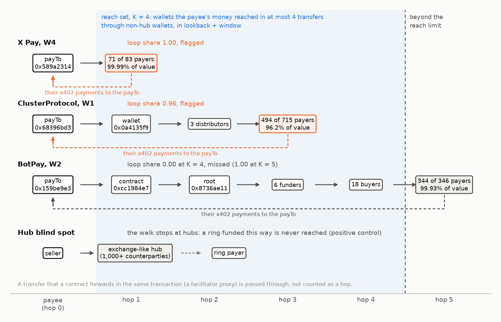

# Results

Every number below is read from the files in this folder by `src/report.py`.

## In plain words

- **The test.** 123 cases (a payee in a 7-day window) from 20 case families on Base x402 and BNB Chain's TermiX escrow, labelled by ChainWard's published decodes. A rule was chosen on 10 development families, frozen in commit `f99f40e`, then scored on 10 held-out families (5 coordinated).
- **The frozen rule** is `loop_share >= 0.4235`: flag a payee when at least 42% of its payment value comes from payers that its own money reached within 4 transfers (not counting exchanges and other hubs).
- **On the test half** it caught 38 of 42 coordinated cases and flagged 1 of 6 others: family-weighted true-positive rate 0.84, false-positive rate 0.20, balanced accuracy 0.82 (bootstrap 95% interval 0.56 to 1.00, 10 families).
- **Misses:** 4 test cases, all F04-botpay's main payTo in its four weeks. Its payers sit five transfers from the payTo, one beyond the reach limit, as written in hypothesis H5 before scoring. At K = 5 their loop share is at least 0.999 in every week.
- **False positive:** F15-losbeto (W4, label N). One payer carried 97% of its payment value ($158.79); in lookback + window the seller sent that same wallet $406.17. The decode read the seller's outflows as payouts. By the ledger the payee and its main payer pay each other; what the payments were for is not on-chain.
- **The other plus factor held up too.** Outside funding share alone (frozen threshold from dev) scored balanced accuracy 0.90 on the test half (TPR 1.00, FPR 0.20); its family-weighted AUC is 1.00 over all cases.
- **Parallel conduct did not separate.** Over all cases the family-weighted AUC was 0.63 for a shared first funder, 0.47 for payer concentration, 0.61 for spending money the moment it arrives and 0.70 for timing coupling, against 0.97 for loop share and 1.00 for outside funding share.
- **Without the circular evidence** (only features the decodes did not use for labelling), the frozen rule `timing_coupling >= -0.001939 AND relay_share >= 0.09579` scored balanced accuracy 0.67 on the test half (TPR 0.54, FPR 0.20).
- **Positive control.** A synthetic seller-funded ring (5 payers, 10 seeds per setting) injected into 12 real markets the rule does not flag was flagged in 100% of runs at half the seller's volume and in 0% of runs at 30% or less, whenever the seller's money reached it within 4 hops (the cut-off is where loop share crosses the threshold: 32% to 42% of volume, depending on the market's existing loop share). Routed over 5 hops or through an exchange-like hub it was never flagged at any size (0% of runs), and five payers funded by one outside wallet with no loop, parallel conduct, were never flagged either (0%).
- **Timing shuffle (negative control).** Circularly shifting each payer's payment times inside the window took the coordinated cases' mean timing coupling from 0.36 to -0.02, and the timing rule's flag rate on them from 0.50 to 0.00; the primary rule, which uses no timing, flagged exactly the same cases. The timing signal is real, but it is weak and its frozen thresholds sit inside the null's sampling noise (its outputs move when the number of null draws changes, see Sensitivity).
- **Chance.** Of the 252 ways to pick 5 coordinated families out of the 10 test families, 2.4% score at least as well under the frozen rule as the real labels (exact permutation p-value).

## The frozen rule

Chosen by `src/select_rule.py` on the development half only (75 cases, 10 families), frozen in commit `f99f40eb42b69b7d90dcf76305db08a6b42f92d2`. Selection: every single-feature threshold and every two-feature AND / OR rule over the eight pre-registered features, scored by family-weighted balanced accuracy; ties went to fewer features, then the widest margin. On dev the primary rule scored balanced accuracy 1.00; all 40 rules kept on the leaderboard in `frozen_rule.json` also scored 1.00 on dev, so the tie-break (fewest features, widest margin) decided. The margin rule put the threshold midway between the dev cases, which all sat near 0 or near 1; partial rings were not in the development set, which is why the positive control finds the cut-off near 42%.

## Errors

- false negative: F04-botpay W1 payee `0x159be9e316bc5fac8ce05aec4eaae46e8f8a4908` (C), loop share 0.000, outside funding share 0.000, payers 298.
- false negative: F04-botpay W2 payee `0x159be9e316bc5fac8ce05aec4eaae46e8f8a4908` (C), loop share 0.000, outside funding share 0.001, payers 346.
- false negative: F04-botpay W3 payee `0x159be9e316bc5fac8ce05aec4eaae46e8f8a4908` (C), loop share 0.000, outside funding share 0.001, payers 346.
- false negative: F04-botpay W4 payee `0x159be9e316bc5fac8ce05aec4eaae46e8f8a4908` (C), loop share 0.001, outside funding share 0.054, payers 346.
- false positive: F15-losbeto W4 payee `0xd5ba9711a3d052846a3695c70e7fcb8b3168fe7d` (N), loop share 0.974, outside funding share 0.625, payers 13.

## Data checks

- Base pull: 157,753,459 USDC transfers, blocks 50,715,727 to 52,530,126, no gaps and no thin segments (`data/base_pull_coverage.json`). 24 segments came from public endpoints; 72 random 40-block ranges in them were re-read from ChainWard's node and all matched row for row (`data/verify_base_public_segments.json`). Three segments from one endpoint were discarded as incomplete and re-pulled (`data/base_pull_discarded_segments.jsonl`).
- BNB Chain pull: 10,325 TermiX hires in the Set and Earn window against 10,325 published; 7 of 7 daily counts equal. Each chunk was queried twice: 0 disagreements. On 30 sampled settlements the escrow paid the agent's ERC-8004 owner 30 times.
- Rings rebuilt from the decode's published description: 48 wallets in closed groups of 24, 12, 12, 218 orders of which 216 settled (published: 48 wallets, 218 orders, 216 settled); the second group has 14 wallets, 38 hires inside on 10-01, 10-04, 10-06, 0 hires in and 1 out (published: 14 wallets, no hire in, one $1 hire out).

## Sensitivity

Primary rule, frozen threshold, features recomputed under each setting. K=1: test TPR 0.59, FPR 0.20; K=2: test TPR 0.59, FPR 0.20; K=3: test TPR 0.80, FPR 0.20; K=4: test TPR 0.84, FPR 0.20; K=5: test TPR 1.00, FPR 0.20; K=6: test TPR 1.00, FPR 0.40; hub>=300: test TPR 0.84, FPR 0.20; hub>=3000: test TPR 0.84, FPR 0.20.

## Circularity

The labels come from ChainWard's own earlier decodes, and most of them were reached by tracing where buyers' money came from. Loop share and outside funding share are close to that evidence for most coordinated families; the timing features, payer concentration and the shared-funder features are not. The rule restricted to features the decodes did not use scored balanced accuracy 0.67 on the test half (exact permutation p = 0.14), which is the honest estimate of what the payment ledger shows without re-deriving the labels.

| family | label | decode_evidence | closest_feature |
|---|---|---|---|
| F01-clusterprotocol | C | seller_to_buyer_funding_path, seller_outflows_to_one_hub | loop_share, no matching feature |
| F02-meridian-six | C | closure_of_payment_set, pair_matrix, no_outside_payments | no matching feature, outside_funding_share |
| F03-meridian-seventh | C | seller_to_buyer_funding_path | loop_share |
| F04-botpay | C | seller_to_buyer_funding_path, payment_tree | loop_share |
| F05-keyring-pingpong | C | direct_reciprocity, seller_funds_buyers | loop_share, loop_share_1hop |
| F06-xpay | C | seller_funds_buyers, first_funder_is_seller | loop_share, shared_funder_share |
| F07-payback-ed9fcd0d | C | direct_reciprocity | loop_share_1hop |
| F08-se-ring48 | C | closure_of_hiring_set, shared_funder | loop_share, shared_funder_share |
| F09-se-group14 | C | closure_of_hiring_set, shared_funder | loop_share, shared_funder_share |
| F10-clashofcoins | I | many_distinct_funders | shared_funder_share |
| F11-blockrun | I | buyers_pay_other_sellers, amount_diversity, no_seller_funding | loop_share, no matching feature |
| F12-stableenrich | I | buyers_pay_other_sellers | no matching feature |
| F13-claw402 | I | many_distinct_funders | shared_funder_share |
| F14-surplusintelligence | N | no_loop_in_seller_outflow_trace | loop_share |
| F15-losbeto | N | no_loop_in_seller_outflow_trace | loop_share |
| F16-cheaptokens | N | no_loop_in_seller_outflow_trace | loop_share |
| F17-ax1 | L | shared_funder_without_seller_path | shared_funder_share |
| F18-korus | L | shared_high_throughput_funder | shared_funder_share |
| F19-roundtrip-ee7ae85f | L | money_returns_through_high_throughput_account | loop_share |
| F20-se-clear-outside | N | no_funding_link_pairwise | loop_share |

## Deviations from the plan

- Two exploratory timing features (`pair_reciprocity_timing`, `payer_synchrony`) were added after a one-day debug run showed that `timing_coupling` saturates for payees that send thousands of transfers. They were added before the full data existed, are reported, and never entered the rule search.
- Before the freeze, the extraction and feature code were smoke-tested on a one-day slice of Sep 22-24 data with a one-day lookback; that run printed feature values for three development cases (F03, F05, F19) and payment counts for test cases, and no test-half feature value was seen before the rule was frozen.
- The fine-grid positive control near the threshold was added after the pre-set grid ran, because that grid jumps from 30% to 50%.
- BNB Chain evidence is TermiX's hire graph only: keyless endpoints cap topic-filtered token queries below 1,000 blocks, so plain USDC/USDT transfers of BNB Chain wallets were not pulled.
- The 48-wallet ring was first rebuilt by id range alone (58 wallets, 10 of them in the 14-wallet group), then as the closed hire components the decode describes, which reproduces its published counts. This was done before any feature was computed.
- Three Base segments from one public endpoint came back incomplete (some ranges answered with no logs) and were discarded and re-pulled; every public-endpoint answer was then required to cover every block, and a sample was re-read from the node.
- A market-level check on TermiX's Base escrow (`src/extract_termix_base.py`, `src/market_check.py`) is written but was not run in this pass.
- F07 (a seller paying 91% of its takings back to its buyers) carries a contested label: the decodes count it as a loop, and it may be a game working as designed. It is in the development half; the primary rule flags it.

## What this does not show

- **Few independent cases.** 10 test families, 5 of them coordinated; the bootstrap interval for balanced accuracy runs from 0.56 to 1.00.
- **One labeller.** Every label is a published ChainWard decode, and decodes publish striking cases; partial rings and borderline sellers are under-represented, which is why the dev-chosen threshold sits near 42% and smaller rings pass it.
- **Money, not control.** The ledger shows where money went, not who controls a wallet or what a payment was for. A seller paying a customer back for a game, a refund or a contractor's work makes the same loop as self-funding (Losbeto against F07).
- **Blind spots.** Loops longer than K hops and loops through exchanges, custodial accounts or bridges are invisible to the reach walk, by construction (positive control: 0% at every size). USDC on Base only: other tokens, ETH and other chains are not followed.
- **No talk.** Payment ledgers carry no messages, so collusive talk that never changes behaviour (case type (c) of question 2.3) cannot be tested here; the nearest analogue is a visible link without a loop (the 12 L cases), of which the primary rule flagged 0.

### Frozen rules on the test half

| rule | text | dev BA (fw) | test TPR (fw) | test FPR (fw) | test BA (fw) | test BA 95% CI | test TP/FN/FP/TN (cases) |
|---|---|---|---|---|---|---|---|
| primary | loop_share >= 0.4235 | 1.00 | 0.84 | 0.20 | 0.82 | [0.56, 1.00] | 38/4/1/5 |
| non_circular | timing_coupling >= -0.001939 AND relay_share >= 0.09579 | 0.93 | 0.54 | 0.20 | 0.67 | [0.40, 0.91] | 17/25/1/5 |
| single:loop_share | loop_share >= 0.4235 | 1.00 | 0.84 | 0.20 | 0.82 | [0.56, 1.00] | 38/4/1/5 |
| single:outside_funding_share | outside_funding_share <= 0.7537 | 1.00 | 1.00 | 0.20 | 0.90 | [0.70, 1.00] | 42/0/1/5 |
| single:loop_share_1hop | loop_share_1hop >= 0.125 | 1.00 | 0.59 | 0.20 | 0.69 | [0.40, 0.98] | 33/9/1/5 |
| single:timing_coupling | timing_coupling >= 0.04143 | 0.84 | 0.59 | 0.20 | 0.70 | [0.44, 0.91] | 17/25/1/5 |
| single:shared_funder_share_nonhub | shared_funder_share_nonhub >= 0.6354 | 0.75 | 0.20 | 0.00 | 0.60 | [0.50, 0.80] | 2/40/0/6 |
| single:shared_funder_share | shared_funder_share >= 0.8571 | 0.75 | 0.20 | 0.00 | 0.60 | [0.50, 0.80] | 2/40/0/6 |
| single:payer_hhi | payer_hhi >= 0.01951 | 0.75 | 0.58 | 1.00 | 0.29 | [0.13, 0.45] | 35/7/6/0 |
| single:relay_share | relay_share >= 0.09579 | 0.72 | 0.64 | 0.40 | 0.62 | [0.33, 0.88] | 26/16/2/4 |

### Errors of the primary rule (both halves)

| half | error | family | window | payee | label | n_payers | loop_share | shared_funder_share | payer_hhi | outside_funding_share |
|---|---|---|---|---|---|---|---|---|---|---|
| test | false negative | F04-botpay | W1 | 0x159be9e316bc5fac8ce05aec4eaae46e8f8a4908 | C | 298 | 0.00 | 0.09 | 0.02 | 0.00 |
| test | false negative | F04-botpay | W2 | 0x159be9e316bc5fac8ce05aec4eaae46e8f8a4908 | C | 346 | 0.00 | 0.10 | 0.00 | 0.00 |
| test | false negative | F04-botpay | W3 | 0x159be9e316bc5fac8ce05aec4eaae46e8f8a4908 | C | 346 | 0.00 | 0.06 | 0.01 | 0.00 |
| test | false negative | F04-botpay | W4 | 0x159be9e316bc5fac8ce05aec4eaae46e8f8a4908 | C | 346 | 0.00 | 0.07 | 0.01 | 0.05 |
| test | false positive | F15-losbeto | W4 | 0xd5ba9711a3d052846a3695c70e7fcb8b3168fe7d | N | 13 | 0.97 | 0.00 | 0.95 | 0.62 |

### Single-feature AUC, family-weighted (* exploratory)

| feature | dev | test | all |
|---|---|---|---|
| Loop share (K=4) | 1.00 | 0.91 | 0.97 |
| Loop share (1 hop) | 1.00 | 0.74 | 0.87 |
| Outside funding share | 1.00 | 1.00 | 1.00 |
| Pair reciprocity timing* | 0.84 | 0.51 | 0.66 |
| Payer concentration (HHI) | 0.71 | 0.21 | 0.47 |
| Payer synchrony* | 0.67 | 0.40 | 0.49 |
| Relay share | 0.61 | 0.57 | 0.61 |
| Shared first funder | 0.58 | 0.74 | 0.63 |
| Shared funder, hubs excluded | 0.58 | 0.82 | 0.71 |
| Timing coupling | 0.83 | 0.62 | 0.70 |

### Exact permutation test on the test half

| rule | test families | coordinated | label assignments | observed BA | p |
|---|---|---|---|---|---|
| primary | 10 | 5 | 252 | 0.820 | 0.024 |
| non_circular | 10 | 5 | 252 | 0.668 | 0.143 |

### Positive control: share of injection runs the primary rule flags, by route and ring share

12 base markets x 10 seeds per cell; excluded because the rule already flags their real data: F15-losbeto|0xd5ba9711a3d052846a3695c70e7fcb8b3168fe7d|W4.

| route | 0.2% | 0.5% | 1.0% | 2.0% | 5.0% | 10.0% | 20.0% | 30.0% | 50.0% |
|---|---|---|---|---|---|---|---|---|---|
| direct | 0.00 | 0.00 | 0.00 | 0.00 | 0.00 | 0.00 | 0.00 | 0.00 | 1.00 |
| relay2 | 0.00 | 0.00 | 0.00 | 0.00 | 0.00 | 0.00 | 0.00 | 0.00 | 1.00 |
| relay4 | 0.00 | 0.00 | 0.00 | 0.00 | 0.00 | 0.00 | 0.00 | 0.00 | 1.00 |
| relay5 | 0.00 | 0.00 | 0.00 | 0.00 | 0.00 | 0.00 | 0.00 | 0.00 | 0.00 |
| via_hub | 0.00 | 0.00 | 0.00 | 0.00 | 0.00 | 0.00 | 0.00 | 0.00 | 0.00 |
| common_funder | 0.00 | 0.00 | 0.00 | 0.00 | 0.00 | 0.00 | 0.00 | 0.00 | 0.00 |

### Positive control near the threshold (supplementary fine grid, added after the pre-set grid ran)

Share of base markets flagged. A ring is flagged exactly when its share passes (threshold - b) / (1 - b), b = the market's existing loop share: 31.5% to 42.4% across the 12 base markets.

| route | 30% | 35% | 38% | 40% | 41% | 42% | 43% | 44% | 45% | 50% |
|---|---|---|---|---|---|---|---|---|---|---|
| direct | 0.00 | 0.08 | 0.08 | 0.17 | 0.17 | 0.17 | 1.00 | 1.00 | 1.00 | 1.00 |
| relay4 | 0.00 | 0.08 | 0.08 | 0.17 | 0.17 | 0.17 | 1.00 | 1.00 | 1.00 | 1.00 |

### Negative control: mean timing features, real vs circularly shifted payment times

| data | coordinated | timing_coupling | relay_share | pair_reciprocity_timing | payer_synchrony |
|---|---|---|---|---|---|
| real timing | 0 | 0.040 | 0.324 | 0.026 | -0.003 |
| real timing | 1 | 0.358 | 0.408 | 0.140 | -0.021 |
| times shuffled | 0 | -0.004 | -0.000 | -0.003 | 0.003 |
| times shuffled | 1 | -0.017 | -0.002 | -0.004 | 0.000 |

### Sensitivity of the frozen rules

Features recomputed under each setting with 20 timing-null draws (200 in the main run); the timing rule's numbers differ from the main run at every setting because its thresholds sit inside the null's sampling noise.

| setting | rule | dev_tpr | dev_fpr | dev_balanced_accuracy | test_tpr | test_fpr | test_balanced_accuracy |
|---|---|---|---|---|---|---|---|
| K=1 | rule | 0.99 | 0.00 | 0.99 | 0.59 | 0.20 | 0.69 |
| K=1 | non_circular_rule | 0.88 | 0.08 | 0.90 | 0.53 | 0.20 | 0.66 |
| K=2 | rule | 0.99 | 0.00 | 0.99 | 0.59 | 0.20 | 0.69 |
| K=2 | non_circular_rule | 0.88 | 0.08 | 0.90 | 0.53 | 0.20 | 0.66 |
| K=3 | rule | 1.00 | 0.00 | 1.00 | 0.80 | 0.20 | 0.80 |
| K=3 | non_circular_rule | 0.88 | 0.08 | 0.90 | 0.53 | 0.20 | 0.66 |
| K=4 | rule | 1.00 | 0.00 | 1.00 | 0.84 | 0.20 | 0.82 |
| K=4 | non_circular_rule | 0.88 | 0.08 | 0.90 | 0.53 | 0.20 | 0.66 |
| K=5 | rule | 1.00 | 0.00 | 1.00 | 1.00 | 0.20 | 0.90 |
| K=5 | non_circular_rule | 0.88 | 0.08 | 0.90 | 0.53 | 0.20 | 0.66 |
| K=6 | rule | 1.00 | 0.00 | 1.00 | 1.00 | 0.40 | 0.80 |
| K=6 | non_circular_rule | 0.88 | 0.08 | 0.90 | 0.53 | 0.20 | 0.66 |
| hub>=300 | rule | 1.00 | 0.00 | 1.00 | 0.84 | 0.20 | 0.82 |
| hub>=300 | non_circular_rule | 0.88 | 0.08 | 0.90 | 0.53 | 0.20 | 0.66 |
| hub>=3000 | rule | 1.00 | 0.00 | 1.00 | 0.84 | 0.20 | 0.82 |
| hub>=3000 | non_circular_rule | 0.88 | 0.08 | 0.90 | 0.53 | 0.20 | 0.66 |

## Figures

*Every feature by label, both halves; the line is the frozen threshold.*

*Positive control: detection of an injected ring by its share of the seller's volume.*

*Single-feature AUC on each half.*

*Timing features with real and shuffled payment times.*

## Added after the freeze (Oct 23 to 24, 2026)

Everything in this section was planned in `cases/market_plan.md` (committed with its one amendment before any market value was computed) and run after the freeze and after the test-half results. The frozen rule, its thresholds and its code are unchanged; nothing here feeds back into them.

### Whole-market run of the frozen rule

- **Base, x402.** Every payee with at least $10 of x402 payments in a window (a payment whose transaction a facilitator on x402scan's public list sent): 750 payee-weeks, 431 distinct payees, $674,944 of x402 volume over W1 to W4. The rule flags 258 payee-weeks (34.4%), 135 of the 431 payees in at least one week, and 29.5% of the volume. 3 payee-weeks hit the reach cap, 0 of them before hop 4.
- **Checks and composition.** The population's x402 volume against the decodes' published weekly totals (same method): W1 98.7%, W2 99.1%, W3 101.0%. The largest payee of W4 took $140,000 in 2 payments, 67.5% of the week (`0xfa02300b1a598daba1b27b2bf79f9775355dac82`, the round-trip payTo of family F19, label L); the rule does not flag it, and without it 39.1% of W4's volume is flagged.
- **Leaderboards.** On Agent402's published top ten of Oct 13, 01:19 UTC (7 days, close to W4), the rule flags ranks 1, 5, 8, 10 in W4: $3,512 of the board's $8,838 (39.7%). Ranked by x402 volume in each window, as x402scan and Agent402 rank, the top 10 payees' volume is 25.3% flagged and the top 50's 29.4%.
- **BNB Chain, Set and Earn.** Every owner of an agent hired on TermiX in the SE window, no floor: 9,131 payees, $495,424 of order budgets. The rule flags 1,276 payees (14.0%) and 14.6% of the volume: all 62 ring wallets and 1,214 of the other 9,069 payees. The BNB Chain evidence is the hire graph only.

Base market by window and by weekly volume band. The decodes' columns are ChainWard's own published weekly x402 totals and loop tiers (x402-on-base-two-weeks-later, same method), given as context: they are the labeller's numbers, not an independent check.

| window | payee-weeks | x402 volume | flagged | volume flagged | outside-funding rule | decode's weekly total | decode's loops (at least) |
|---|---|---|---|---|---|---|---|
| W1 | 216 | $126,527 | 89 (41%) | 49.4% | 49.1% | $128,252 | 46.8% |
| W2 | 190 | $230,801 | 56 (29%) | 26.8% | 27.6% | $232,810 | 25.7% |
| W3 | 179 | $110,254 | 71 (40%) | 44.2% | 44.9% | $109,151 | 40.6% |
| W4 | 165 | $207,363 | 42 (25%) | 12.7% | 12.9% |  |  |
| band $10-100 | 548 | $16,147 | 179 (33%) | 35.9% | 32.3% |  |  |
| band $100-1k | 135 | $40,006 | 46 (34%) | 32.1% | 40.6% |  |  |
| band >=$1k | 67 | $618,791 | 33 (49%) | 29.2% | 29.2% |  |  |

### Blinded spot-check

- **Sample.** 40 Base payees the published decodes did not examine (not printed in any decode, not a case, never in a window's top 30), drawn with seed 20261024: 25 the rule flags and 15 it does not, shuffled into one list. Two separate AI agent sessions judged each from on-chain evidence alone, with read-only tools over the same transfers, and never saw a feature value, flag, the rule or the stratum (`cases/spotcheck_judge_protocol.md`, `cases/spotcheck_judge_prompt.md`). Both verdict files were committed before the key was joined.
- **Judge A.** Of the 25 flagged payees, 22 coordinated, 3 independent, 0 unclear (share coordinated 88%, 95% interval 69% to 97%); of the 15 unflagged, 4 coordinated, 10 independent, 1 unclear (misses 27%, 8% to 55%). Agrees with the rule on 32 of 40.
- **Judge B.** Of the 25 flagged payees, 20 coordinated, 3 independent, 2 unclear (share coordinated 80%, 95% interval 59% to 93%); of the 15 unflagged, 4 coordinated, 10 independent, 1 unclear (misses 27%, 8% to 55%). Agrees with the rule on 30 of 40.
- **Between judges.** Same verdict on 38 of 40. Where both gave the same verdict and it was not unclear (37 payees), the rule agrees on 30: 20 of 23 flagged and 4 of 14 unflagged are coordinated.
- **Where both judges disagree with the rule.** Flagged but independent: S02, S03, S37. In each, by the judges' reasoning, the payee sent its payers small refunds or change (in one, hours after the payment), and the reach walk counts a payer the payee paid whatever the amount or the order. Their outside funding share is 0.95, 0.55, 0.86, against the frozen outside-funding cut-off of 0.75. Unflagged but coordinated: S07, S17, S35, S39: two payers whose only USDC came from the payee in May, months before the data starts, and two wallets of BotPay's ring at five hops (next bullet).
- **The other frozen plus-factor rule (post hoc).** On the same 37 consensus verdicts, the frozen `outside_funding_share <= 0.7537` agrees on 29, with 1 false positive(s) and 7 misses, against 30, 3 and 4 for the primary rule.
- **One ring, many payees (post hoc, after unblinding; `scripts/diag_botpay_ring.py`).** 48 of the 135 flagged payees are mostly paid by wallets that BotPay's root wallet [D4], or a wallet it paid, funded (107 payee-weeks, $3,878). The rule flags 86 of their 86 payee-weeks in W1 to W3 and 0 of 21 in W4; rerun at K = 6, the main payer of every W4 one sits at hop 5, one beyond the limit. Counts of flagged payees therefore overstate the number of operators.

Every sample, after unblinding (full reasoning in `results/spotcheck_unblinded.csv`):

| sample_id | payee | window | flag_primary | loop_share | outside_funding_share | n_payers | volume | verdict_A | est_coordinated_share_A | verdict_B | est_coordinated_share_B |
|---|---|---|---|---|---|---|---|---|---|---|---|
| S01 | 0x4ad9fcc1 | W2 | False | 0.00 | 1.00 | 1 | 10.30 | independent | 0.00 | independent | 0.00 |
| S02 | 0x6bab1d63 | W3 | True | 1.00 | 0.95 | 3 | 12.76 | independent | 0.00 | independent | 0.00 |
| S03 | 0x0bd02144 | W2 | True | 1.00 | 0.55 | 1 | 85.00 | independent | 0.00 | independent | 0.00 |
| S04 | 0x7f629403 | W2 | False | 0.00 | 1.00 | 2 | 20.00 | independent | 0.00 | independent | 0.00 |
| S05 | 0x1c656644 | W2 | True | 1.00 | 0.76 | 1 | 23.74 | coordinated | 1.00 | coordinated | 1.00 |
| S06 | 0x836be278 | W4 | False | 0.00 | 1.00 | 5 | 14.31 | unclear |  | unclear |  |
| S07 | 0xbc5bafda | W3 | False | 0.00 | 1.00 | 1 | 11.00 | coordinated | 1.00 | coordinated | 1.00 |
| S08 | 0x837c40e2 | W3 | True | 0.90 | 0.54 | 4 | 97.21 | coordinated | 0.70 | coordinated | 0.70 |
| S09 | 0xd593832c | W3 | True | 0.96 | 0.91 | 14 | 34.95 | coordinated | 0.95 | coordinated | 0.95 |
| S10 | 0x85af15f3 | W1 | True | 1.00 | 0.00 | 1 | 22.70 | coordinated | 1.00 | coordinated | 1.00 |
| S11 | 0x768d3897 | W1 | True | 1.00 | 0.00 | 1 | 70.70 | coordinated | 1.00 | coordinated | 1.00 |
| S12 | 0xb7c76e6a | W1 | False | 0.00 | 1.00 | 1 | 12.00 | independent | 0.00 | independent | 0.00 |
| S13 | 0xe6dab093 | W1 | True | 1.00 | 0.00 | 1 | 22.70 | coordinated | 1.00 | coordinated | 1.00 |
| S14 | 0xd8ba61a0 | W4 | True | 1.00 | 0.27 | 3 | 37.68 | coordinated | 1.00 | coordinated | 1.00 |
| S15 | 0xce668a6e | W1 | True | 1.00 | 0.00 | 9 | 10.00 | coordinated | 1.00 | coordinated | 1.00 |
| S16 | 0x17d38086 | W1 | True | 1.00 | 0.00 | 1 | 22.50 | coordinated | 1.00 | coordinated | 1.00 |
| S17 | 0xaf6ee95c | W4 | False | 0.00 | 0.00 | 1 | 17.50 | coordinated | 1.00 | coordinated | 1.00 |
| S18 | 0x0a84297d | W3 | True | 1.00 | 0.00 | 1 | 25.20 | coordinated | 1.00 | coordinated | 1.00 |
| S19 | 0x33e59490 | W1 | False | 0.00 | 1.00 | 1 | 35.00 | independent | 0.00 | independent | 0.00 |
| S20 | 0x788b4ca1 | W1 | True | 1.00 | 0.90 | 5 | 43.05 | coordinated | 0.97 | coordinated | 0.98 |
| S21 | 0x4df66b6c | W2 | False | 0.00 | 1.00 | 13 | 25.24 | independent | 0.00 | independent | 0.00 |
| S22 | 0x4cd50150 | W1 | False | 0.00 | 1.00 | 1 | 24.10 | independent | 0.00 | independent | 0.00 |
| S23 | 0xc34f3d05 | W1 | False | 0.00 | 1.00 | 1 | 60.47 | independent | 0.00 | independent | 0.00 |
| S24 | 0x07e079b1 | W1 | False | 0.00 | 1.00 | 1 | 100.20 | independent | 0.00 | independent | 0.00 |
| S25 | 0x430a232c | W3 | True | 1.00 | 0.00 | 1 | 16.60 | coordinated | 1.00 | coordinated | 1.00 |
| S26 | 0xf1cbc619 | W1 | False | 0.00 | 1.00 | 1 | 10.20 | independent | 0.00 | independent | 0.00 |
| S27 | 0x8060f6e3 | W3 | True | 1.00 | 0.00 | 1 | 24.50 | coordinated | 1.00 | coordinated | 1.00 |
| S28 | 0x434ca49f | W1 | True | 1.00 | 0.00 | 1 | 22.70 | coordinated | 1.00 | coordinated | 1.00 |
| S29 | 0x3a876a77 | W3 | True | 1.00 | 0.00 | 1 | 16.60 | coordinated | 1.00 | coordinated | 1.00 |
| S30 | 0x91410228 | W1 | True | 0.69 | 0.48 | 2 | 16.00 | coordinated | 0.69 | coordinated | 0.69 |
| S31 | 0x96368628 | W4 | True | 0.92 | 0.23 | 7 | 105.80 | coordinated | 0.90 | coordinated | 0.92 |
| S32 | 0x8aab9a6d | W3 | True | 0.94 | 0.84 | 6 | 12.60 | coordinated | 0.94 | coordinated | 0.94 |
| S33 | 0x6454a645 | W4 | True | 1.00 | 0.12 | 1 | 11.04 | coordinated | 0.95 | coordinated | 0.94 |
| S34 | 0xf3ecfe1d | W3 | True | 1.00 | 0.99 | 1 | 15.30 | coordinated | 1.00 | unclear |  |
| S35 | 0x0748cc42 | W3 | False | 0.00 | 1.00 | 1 | 10.20 | coordinated | 1.00 | coordinated | 1.00 |
| S36 | 0xeb931657 | W2 | False | 0.00 | 1.00 | 1 | 29.76 | independent | 0.00 | independent | 0.00 |
| S37 | 0x4f180b77 | W1 | True | 1.00 | 0.86 | 6 | 61.95 | independent | 0.00 | independent | 0.00 |
| S38 | 0x5976376b | W3 | True | 0.88 | 0.99 | 23 | 15.52 | coordinated | 0.88 | unclear |  |
| S39 | 0xb13b783a | W4 | False | 0.00 | 0.00 | 1 | 30.90 | coordinated | 1.00 | coordinated | 1.00 |
| S40 | 0x0440383b | W3 | True | 0.91 | 0.86 | 9 | 67.00 | coordinated | 0.50 | coordinated | 0.50 |

### A public label source ChainWard did not write

Agent402's public index (read 2026-10-23 16:04 UTC) gives 58 payees of the Base market a settlement verdict. Its `settlement_self_funded` verdict nets USDC the seller sent a payer against that payer's later payments (one hop, first in first out, the seller's history up to the read) and marks a seller whose remaining history is below the router's floor. Rule flag in any week against that verdict: flagged and self-funded 7, flagged and not 19, not flagged and self-funded 2, neither 30 (`results/market_agent402_comparison.csv`). A seller with enough independent history is not marked whatever its loops, so the verdict is a floor gate, not a loop measurement, and the periods differ; this is agreement, not accuracy. BNB Chain: no public label source we know of.

### End-to-end positive control

A seller-funded ring of 5 payers was written as USDC transfers and EIP-3009 authorisations into the data the extraction reads, for 3 markets the rule does not flag (F10-clashofcoins, F12-stableenrich, F16-cheaptokens), 6 routes and 5 ring shares each (90 runs); `src/extract_base.py` and `src/features.py` ran unchanged. Expected loop share: phi + (1 - phi) b when the route reaches the ring within 4 transfers, (1 - phi) b otherwise, with b the market's own loop share. Largest difference between measured and expected: 1.1e-16. Flag as predicted in 90 of 90 runs, ring payers at the designed distance in 90 of 90, every synthetic payment extracted: True. The synthetic rows lived in a scratch database that read `data/base.duckdb` read-only: its row counts were 157,753,459 transfers before and 157,753,459 after, the file was unchanged (True) and the scratch database was deleted (True).

| route | runs | designed_hop | hops_measured | max_abs_error | flags_as_predicted |
|---|---|---|---|---|---|
| direct | 15 | 1 | 1 | 1.1e-16 | 15 |
| relay3 | 15 | 3 | 3 | 1.1e-16 | 15 |
| relay4 | 15 | 4 | 4 | 1.1e-16 | 15 |
| relay5 | 15 | 5 | 5 | 5.6e-17 | 15 |
| via_hub | 15 | not reached | none | 2.8e-17 | 15 |
| via_forwarder | 15 | 1 | 1 | 5.6e-17 | 15 |

Baselines measured by the same pipeline with no ring, against the committed case features: F10-clashofcoins W1 b = 0.000000 (0.000000); F12-stableenrich W1 b = 0.000000 (0.000000); F16-cheaptokens W4 b = 0.158133 (0.158133).

### Deviations and notes (after the freeze)

- The plan read every transaction sender from ChainWard's node; at about 250 a second (its disk is the bottleneck) that was 2.7 hours, so an amendment committed before any population count reads senders for candidate payees only, exactly for those with at most 1,000 payment transactions in a week and from 1,000 value-weighted draws for the others (133 of the 750 payee-weeks in the population).
- The first run of the end-to-end control scored the four-relay route (hop 5) against the within-K expectation, a bug in its summary code, not in the pipeline: the measured loop shares were already (1 - phi) b. The expectation was fixed and the control re-run before any of it was reported.
- One BNB Chain decode prints four of the 62 ring wallets as hiring examples. Their tokens are dropped from `data/decode_printed_hex.txt`, which lists what the decodes print, so that no committed file names a ring wallet; no ring wallet is a Base payee in the population, so the exclusions do not change.
- The market features and the spot-check key stayed outside the repository until both verdict files were committed. The judges are AI agent sessions, not human investigators, and both read the same tools.

### Reach walk

*The reach walk, with worked examples from the committed case tables: X Pay's payers one transfer from its payTo, ClusterProtocol's three, BotPay's five (one beyond K = 4). A ledger cannot tell one operator with many wallets from colluding agents: both leave the same money paths.*

